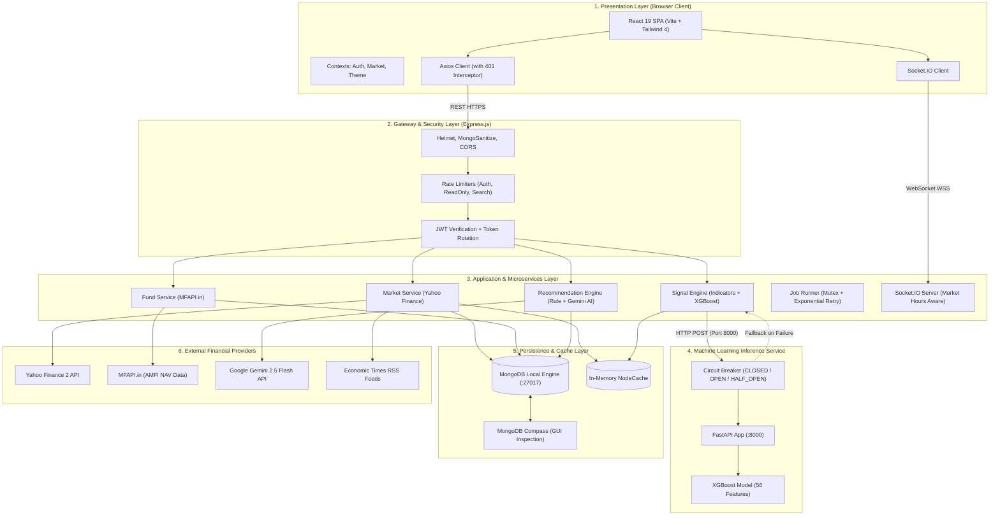
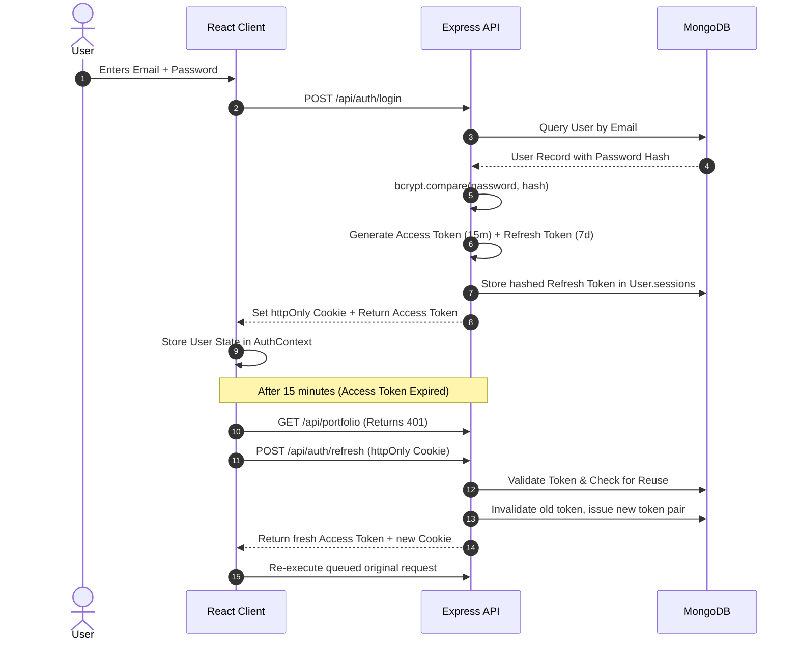
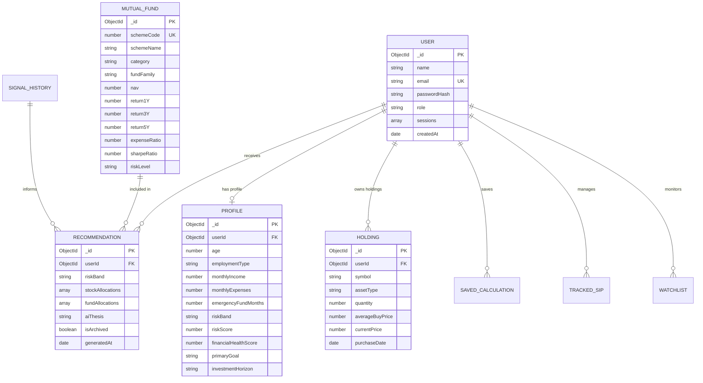

# 🚀 Rupeemind — Comprehensive Technology Stack & Architecture Specification

> **Version:** 1.0.0 | **Status:** Production-Ready | **Target Platform:** Web (Desktop & Mobile Responsive)
> **Repository:** `rupeemind` | **Database:** MongoDB (Managed locally via MongoDB Compass at `mongodb://127.0.0.1:27017/rupeemind`)

---

## 📑 Table of Contents

1. [Executive Overview](#1-executive-overview)
2. [Categorized Technology Stack](#2-categorized-technology-stack)
   - [2.1 Frontend Tier](#21-frontend-tier)
   - [2.2 Backend & API Tier](#22-backend--api-tier)
   - [2.3 Machine Learning & Data Science Tier](#23-machine-learning--data-science-tier)
   - [2.4 Database, Storage & Caching Tier](#24-database-storage--caching-tier)
   - [2.5 DevOps, Build & Testing Infrastructure](#25-devops-build--testing-infrastructure)
3. [System Architecture & Resilience Engineering](#3-system-architecture--resilience-engineering)
   - [3.1 High-Level Architecture Diagram](#31-high-level-architecture-diagram)
   - [3.2 Multi-Tier Interaction & Data Flow](#32-multi-tier-interaction--data-flow)
   - [3.3 Circuit Breaker & Graceful Degradation](#33-circuit-breaker--graceful-degradation)
   - [3.4 Real-Time WebSocket Streaming](#34-real-time-websocket-streaming)
4. [Website Workflow & User Journeys](#4-website-workflow--user-journeys)
   - [4.1 Authentication & Session Lifecycle](#41-authentication--session-lifecycle)
   - [4.2 5-Step Investor Onboarding & Profiling](#42-5-step-investor-onboarding--profiling)
   - [4.3 Real-Time Market Intelligence & Stock Signals](#43-real-time-market-intelligence--stock-signals)
   - [4.4 Algorithmic & AI Portfolio Recommendations](#44-algorithmic--ai-portfolio-recommendations)
   - [4.5 Portfolio Management & SIP Execution](#45-portfolio-management--sip-execution)
   - [4.6 Interactive Financial Calculators & News Feed](#46-interactive-financial-calculators--news-feed)
   - [4.7 Virtual Paper Trading Engine & Indian Statutory Charges Simulation](#47-virtual-paper-trading-engine--indian-statutory-charges-simulation)
   - [4.8 Advanced Quantitative Risk, Crisis Stress-Testing & Monte Carlo Simulator](#48-advanced-quantitative-risk-crisis-stress-testing--monte-carlo-simulator)
   - [4.9 RupeeBot — Context-Aware AI Financial Copilot](#49-rupeebot--context-aware-ai-financial-copilot)
   - [4.10 Institutional Portfolio Audit & Print-Ready PDF Dossier](#410-institutional-portfolio-audit--print-ready-pdf-dossier)
   - [4.11 Mutual Fund Deep-Dive & Scheme Comparison Matrix](#411-mutual-fund-deep-dive--scheme-comparison-matrix)
   - [4.12 Financial Literacy Academy & Educational Interactive Guides](#412-financial-literacy-academy--educational-interactive-guides)
5. [Database Architecture & Schema Design](#5-database-architecture--schema-design)
   - [5.1 Entity-Relationship (ER) Overview](#51-entity-relationship-er-overview)
   - [5.2 Detailed Collection & Model Dictionary](#52-detailed-collection--model-dictionary)
   - [5.3 Indexing Strategy for Performance](#53-indexing-strategy-for-performance)
6. [API Catalog & External Data Ingestion](#6-api-catalog--external-data-ingestion)
   - [6.1 External Data Sources & Ingestion Pipelines](#61-external-data-sources--ingestion-pipelines)
   - [6.2 Internal REST API Endpoints Catalog](#62-internal-rest-api-endpoints-catalog)
   - [6.3 WebSocket Event Contracts](#63-websocket-event-contracts)
7. [Security & Reliability Posture](#7-security--reliability-posture)
8. [Verification & Project Health](#8-verification--project-health)
9. [Deployment, Environment Configuration & Local Run Guide](#9-deployment-environment-configuration--local-run-guide)
   - [9.1 Environment Variables Specification](#91-environment-variables-specification)
   - [9.2 Single-Command Orchestration & Execution](#92-single-command-orchestration--execution)
   - [9.3 MongoDB Local Engine & Compass Inspection](#93-mongodb-local-engine--compass-inspection)
   - [9.4 Production Build & Bundling Verification](#94-production-build--bundling-verification)

---

## 1. Executive Overview

**Rupeemind** is an enterprise-grade, full-stack financial technology platform tailored specifically for Indian retail investors. The system democratizes quantitative investment analysis by combining:

- **Rule-based technical analysis** (RSI, MACD, Bollinger Bands, Moving Average crossovers).
- **Machine Learning predictive models** (XGBoost with 56 engineered technical indicators).
- **Generative AI** (Google Gemini 2.5 Flash) for explainable investment theses and contextual risk warnings.
- **Mutual fund algorithmic scoring** based on historical risk-adjusted returns (Sharpe ratio, alpha, beta, standard deviation).
- **Institutional-grade security** featuring rotating refresh tokens, session reuse theft prevention, and NoSQL injection protection.

---

## 2. Categorized Technology Stack

```
===================================================================================================
                                RUPEEMIND MONOREPO ARCHITECTURE
===================================================================================================
[ Client Layer ]       React 19 • TypeScript 6 • Tailwind CSS 4 • Vite 8 • Recharts • Framer Motion
      ↕ (REST + WS)
[ Server Layer ]       Node.js 22 • Express 4 • TypeScript Types • Mongoose 8 • Socket.IO • Helmet
      ↕ (Internal HTTP)
[ ML Layer ]           Python 3.10+ • FastAPI • XGBoost • scikit-learn • pandas • numpy
      ↕ (MongoDB Wire)
[ Database Layer ]     MongoDB Local Engine (Monitored & Managed via MongoDB Compass) • Node-Cache
===================================================================================================
```

### 2.1 Frontend Tier

| Technology | Version | Purpose & Rationale |
| --- | --- | --- |
| **React** | `^19.2.8` | Declarative UI framework with latest concurrent rendering and optimized transitions. |
| **TypeScript** | `~6.0.2` | Complete compile-time type safety across all components, props, contexts, and API contracts. |
| **Vite** | `^8.3.0` | Ultra-fast native ESM frontend build tool; generates optimized production chunks in under 4 seconds. |
| **Tailwind CSS** | `^4.3.3` | Utility-first CSS framework integrated via `@tailwindcss/vite` for a sleek dark/light mode financial dashboard. |
| **React Router DOM** | `^7.18.4` | Declarative client-side routing with lazy-loaded route chunks and code splitting via `React.lazy()`. |
| **Recharts** | `^3.10.1` | High-performance SVG charting library for interactive stock candlestick/line charts, asset allocation donuts, and drawdown graphs. |
| **Framer Motion** | `^14.0.0` | Spring-physics micro-animations for page transitions, drawers, modal dialogs, and progress bars. |
| **Lucide React** | `^1.52.0` | Consistent, lightweight SVG iconography across all financial UI components. |
| **Socket.IO Client** | `^4.8.4` | WebSocket client for bi-directional real-time market quote streaming. |
| **Axios** | `^1.20.0` | HTTP client configured with automatic queued 401 token refresh interceptors. |
| **Sonner** | `^2.0.8` | Toast feedback system with custom glassmorphic financial theme styling. |

### 2.2 Backend & API Tier

| Technology | Version | Purpose & Rationale |
| --- | --- | --- |
| **Node.js** | `>= 20.x` (ESM) | High-concurrency JavaScript runtime operating natively with ES Modules (`import/export`). |
| **Express.js** | `^4.21.2` | Minimalist web application framework powering 15 modular RESTful route controllers. |
| **TypeScript Typecheck** | `^7.0.2` | Server-side TypeScript environment (`tsconfig.json`, `index.d.ts`) enabling `tsc --noEmit` build verification. |
| **Mongoose** | `^8.12.0` | Object Data Modeling (ODM) for MongoDB with schema validation, hooks, and automated cascading deletions. |
| **Socket.IO** | `^4.8.4` | WebSocket server delivering real-time stock updates to clients during Indian market trading hours (IST). |
| **Helmet** | `^8.0.0` | Security middleware configuring HTTP headers (HSTS, CSP, X-Frame-Options, Referrer-Policy). |
| **express-rate-limit** | `^7.5.0` | 5 specialized rate-limiting tiers preventing DDoS, brute-force password guessing, and search query abuse. |
| **jsonwebtoken (JWT)** | `^9.0.2` | Cryptographic JWT generator implementing dual-token authentication (short-lived access + rotating refresh). |
| **bcryptjs** | `^2.4.3` | Password hashing using adaptive salt rounds (cost factor 12) for brute-force resistance. |
| **Zod** | `^3.24.2` | Strict runtime schema validation for user payloads, auth inputs, and profile forms. |
| **Nodemailer** | `^10.0.15` | SMTP transport for automated password reset emails, account recovery, and SIP schedule alerts. |
| **Node-Cron** | `^4.6.0` | In-process scheduling for daily mutual fund synchronization and periodic market cache invalidation. |
| **technicalindicators** | `^3.1.0` | Technical analysis calculation library (RSI, MACD, Bollinger Bands, SMA, EMA, Stochastic) for rule-based signals. |

### 2.3 Machine Learning & Data Science Tier

| Technology | Purpose & Rationale |
| --- | --- |
| **Python** (`3.10+`) | Primary scientific computing language powering data transformations and ML pipelines. |
| **FastAPI** | High-performance asynchronous microservice serving ML predictions over local HTTP (`:8000`). |
| **XGBoost** | Extreme Gradient Boosting classifier trained on 56 engineered technical indicators for market direction prediction. |
| **scikit-learn** | Feature scaling, cross-validation, train/test splitting, precision/recall evaluation metrics. |
| **pandas & numpy** | High-throughput time-series data wrangling, candle resample, and multi-asset dataset merging. |
| **Uvicorn** | ASGI server running the FastAPI prediction microservice with health checks. |

### 2.4 Database, Storage & Caching Tier

| Technology | Configuration / Role | Purpose & Rationale |
| --- | --- | --- |
| **MongoDB Local Engine** | Port `27017` | Document-oriented NoSQL database storing user accounts, financial profiles, holdings, and fund data. |
| **MongoDB Compass** | GUI Tool | Visual database management, index inspection, query profiling, and schema exploration at `mongodb://127.0.0.1:27017/rupeemind`. |
| **Node-Cache** | In-Memory (Server) | Sub-millisecond volatile caching for stock market quotes (15s), signals (15m), and rate limiter counters. |

### 2.5 DevOps, Build & Testing Infrastructure

| Technology | Purpose |
| --- | --- |
| **Vitest** (`v5.0.3`) | High-speed unit and integration test runner for client math utilities and server auth/security flows (64 tests). |
| **Supertest** (`^7.3.1`) | Programmatic HTTP assertion library for backend controller and route integration tests. |
| **ESLint** (`^10.12.0`) | Automated code quality, React hooks linting, and TypeScript syntax enforcement across the monorepo. |
| **Concurrently** (`^10.0.5`) | Unified development orchestrator running frontend Vite and backend nodemon with a single `npm run dev` command. |
| **GitHub Actions** | Automated CI pipeline (`ci.yml`) validating builds, server typechecks, and test suites on pull requests. |

---

## 3. System Architecture & Resilience Engineering

### 3.1 High-Level Architecture Diagram



### 3.2 Multi-Tier Interaction & Data Flow

1. **User Request Initiation**: The React 19 SPA sends authenticated REST requests using Axios with `withCredentials: true`.
2. **Security & Middleware Validation**:
   - `helmet` applies strict security headers.
   - `mongoSanitize` strips dangerous keys containing `$` or `.` to prevent NoSQL injection.
   - `rateLimiter` checks bucket tokens based on client IP.
   - `authMiddleware` validates the Bearer JWT or reads the HTTP-only refresh cookie.
3. **Service Execution & Caching**: The controller delegates business logic to specialized services (`marketService`, `fundService`, `signalService`). Services check `NodeCache` before triggering external API requests.
4. **Data Persistence**: Mongoose executes schema-validated queries against the local MongoDB instance on port 27017.

### 3.3 Circuit Breaker & Graceful Degradation

To ensure the platform never fails even if the Python ML microservice crashes or experiences latency:

```
[Incoming Prediction Request]
              |
       [Check Circuit State]
       /        |         \
  (CLOSED)  (HALF-OPEN)   (OPEN)
     /          |            \
[Call ML API] [Probe Test]  [Bypass ML API]
     |          |            /
 (Success?)  (Success?)     /
   /    \       /   \      /
(Yes)   (No)  (Yes) (No)  /
  |       \     |     \  /
[Return]  [Trip to OPEN]
  ML        \
Signal       --> [EXECUTE LOCAL RULE-BASED FALLBACK]
                 (Calculate RSI, MACD, Bollinger Bands in Node.js)
                 [Return Safe Algorithmic Signal]
```

- **CLOSED**: Requests flow normally to FastAPI at `http://127.0.0.1:8000/predict`.
- **OPEN**: If 3 consecutive failures occur, circuit trips to OPEN for 60 seconds. All incoming requests bypass Python and instantly compute rule-based signals in Node.js with zero downtime.
- **HALF-OPEN**: After the timeout, a probe request tests the ML service. If successful, the circuit resets to CLOSED.

### 3.4 Real-Time WebSocket Streaming

- Socket.IO establishes a bi-directional event tunnel between the client and server.
- The server checks **IST Trading Hours** (Monday–Friday, 9:15 AM to 3:30 PM IST):
  - **Market Open**: Ticker polling triggers every 15 seconds, broadcasting delta changes to active room subscribers.
  - **Market Closed**: Polling halts automatically to preserve server resources and prevent external rate-limiting.

---

## 4. Website Workflow & User Journeys

### 4.1 Authentication & Session Lifecycle



### 4.2 5-Step Investor Onboarding & Profiling

Users undergo a structured 5-step risk assessment to calculate their risk capacity and financial health:

1. **Step 1: Personal & Employment Background**: Age bracket, profession, dependent count, investment experience.
2. **Step 2: Financial Cashflow & Stability**: Monthly in-hand income, fixed monthly expenses, emergency fund coverage (months).
3. **Step 3: Risk Tolerance & Market Psychology**: Reaction to a 20% portfolio drop (panic sell, hold, or buy the dip), risk appetite.
4. **Step 4: Goals & Time Horizon**: Primary investment goal (wealth creation, retirement, house purchase, tax savings) and investment duration (1–3 yrs, 3–7 yrs, 7+ yrs).
5. **Step 5: Review & Algorithmic Scoring**:
   - Calculates **Risk Score (0–100)** and categorizes into **Conservative**, **Moderate**, or **Aggressive**.
   - Calculates **Financial Health Score (0–100)** evaluating debt-to-income and emergency savings ratios.
   - Generates actionable financial improvement tips.

### 4.3 Real-Time Market Intelligence & Stock Signals

- **Market Overview Page**: Displays live indices (Nifty 50, Sensex), top gainers, top losers, market breadth, and sector performance.
- **Stock Detail Page**: Interactive TradingView-style candlestick and price chart, automated technical indicator dashboard (RSI 14, MACD 12/26/9, Bollinger Bands 20/2, 20/50/200 EMA crossovers).
- **Signal Summary**: Clear action badges (**STRONG BUY**, **BUY**, **HOLD**, **SELL**, **STRONG SELL**) with quantitative confidence scores (0–100%) and 5-year walk-forward backtest results.

### 4.4 Algorithmic & AI Portfolio Recommendations

- Combines modern portfolio theory with Indian mutual fund scheme metrics:
  - **Equity Stock Allocations**: Filtered based on user risk score, momentum, and technical health.
  - **Mutual Fund Allocations**: Top-quartile direct growth mutual funds selected by Sharpe ratio, expense ratio (< 1.0%), and 3Y/5Y alpha.
  - **Google Gemini AI Thesis**: Provides plain-language explanations of *why* each asset is recommended, macro risks, and rebalancing timelines.
  - **Comparison Drawer**: Side-by-side asset comparison across returns, volatility, expense ratio, and risk band.

### 4.5 Portfolio Management & SIP Execution

- **Holdings Management**: Add and track equity stocks and mutual fund holdings with real-time unrealized P&L and invested value.
- **Asset Allocation Charts**: Visual donut breakdown across Large Cap, Mid Cap, Small Cap, Debt, and Hybrid funds.
- **SIP Tracker & Calculator**: Track monthly SIP installments, upcoming deduction schedules, projected corpus at maturity, and XIRR (Extended Internal Rate of Return).

### 4.6 Interactive Financial Calculators & News Feed

- **Calculators Suite**:
  - SIP Calculator (Monthly wealth accumulation with compound interest).
  - Lumpsum Investment Calculator.
  - SWP (Systematic Withdrawal Plan) Calculator for retirement cashflows.
  - Step-Up SIP Calculator (Annual increment in SIP amount).
  - Goal Planning Calculator (Target corpus backwards calculation).
- **Financial News**: Curated RSS feed from the Economic Times with sentiment tags, market updates, and category filters.

### 4.7 Virtual Paper Trading Engine & Indian Statutory Charges Simulation

- **Risk-Free Capital Allocation**: Every onboarded user receives a dedicated virtual wallet pre-seeded with **₹10,00,000 (10 Lakhs)** in virtual capital ([models/PaperWallet.js](file:///e:/MainProject/server/src/models/PaperWallet.js)).
- **Order Execution Lifecycle**: Supports both instant **MARKET** orders (executed at latest tick price) and queued **LIMIT** orders (monitored against live NSE price updates).
- **Authentic Indian Regulatory Fee Model**: Real-time deduction and itemization of Indian exchange transaction charges:
  - **Securities Transaction Tax (STT)**: 0.1% on equity delivery turnover.
  - **Exchange Turnover Charges**: 0.00345% (NSE rate).
  - **SEBI Turnover Fee**: 0.0001% (₹10 per crore).
  - **GST**: 18% levied on brokerage and exchange charges.
  - **Stamp Duty**: 0.015% on buy-side transactions.
- **Position Management & Liquidation**: Live weighted average cost price tracking, real-time unrealized P&L calculations, partial or complete position exits, and transaction history with trade receipts.

### 4.8 Advanced Quantitative Risk, Crisis Stress-Testing & Monte Carlo Simulator

- **Parametric Value at Risk (VaR)**:
  - Implements **Basel III regulatory standards** calculating 1-day and 10-day VaR at **95% and 99% confidence levels** based on the variance-covariance matrix of user holdings.
  - **Expected Shortfall (Conditional VaR / CVaR)**: Quantifies the expected catastrophic loss beyond the VaR threshold.
- **Historical Crisis Stress Testing & Shock Scenarios**:
  - Replays historical black swan financial crises against current user holdings with asset-class specific beta adjustments:
    - **2008 Global Financial Crisis (Lehman Collapse)**: -52% Equity shock, flight to safety in sovereign debt.
    - **2020 COVID-19 Liquidity Shock**: -38% Rapid crash followed by high-beta tech rebound.
    - **2016 Indian Demonetization Shock**: -12% Cashflow crunch and banking sector volatility.
    - **2022 Global Rate-Hike & Inflation Spiral**: -18% Tech and growth equity contraction.
  - **Custom Interactive Shock Sliders**: Allows investors to stress-test arbitrary equity shocks (-50% to +50%), bond yield shifts, and rupee depreciation.
- **1,000-Path Monte Carlo Geometric Brownian Motion (GBM)**:
  - Simulates 1,000 randomized walk-forward price trajectories over 30, 90, 180, and 365 trading days.
  - Computes 5th percentile (bear case), 50th percentile (median projection), and 95th percentile (bull case) future portfolio valuations.

### 4.9 RupeeBot — Context-Aware AI Financial Copilot

- **Seamless Global Access**: Accessible across all application routes via a dedicated floating trigger button or global keyboard shortcut (`Ctrl + J`).
- **Full Portfolio & Risk Grounding**: Automatically retrieves and injects the user's real-time portfolio holdings, asset allocation percentages, recent paper trades, and risk capacity score into the system prompt context.
- **Google Gemini 2.5 Integration**: Uses Google's multimodal LLM to provide multi-turn conversational advisory, tax-harvesting suggestions, risk mitigation explanations, and jargon-free investment education.
- **Compliance & Guardrails**: Enforces SEBI-compliant financial educational disclaimers, refrains from executing unverified trade orders without explicit user confirmation, and logs full multi-turn conversations in MongoDB ([models/CopilotChat.js](file:///e:/MainProject/server/src/models/CopilotChat.js)).

### 4.10 Institutional Portfolio Audit & Print-Ready PDF Dossier

- **One-Click Institutional Audit**: Aggregates comprehensive quantitative metrics including portfolio Sharpe ratio, Sortino ratio, beta, maximum historical drawdown, and diversification index.
- **Print-Ready Clean PDF Export**: Generates an institutional-grade, multi-page financial health report utilizing optimized `@media print` styling, SVG vector charts, holding matrices, and executive summaries.
- **Rebalancing Advisory Matrix**: Highlights concentrated stock positions exceeding 15% thresholds, identifies underweight fixed-income allocations, and recommends tax-efficient rebalancing steps.

### 4.11 Mutual Fund Deep-Dive & Scheme Comparison Matrix

- **Real-Time AMFI / MFAPI Ingestion**: Tracks over 40+ direct growth mutual fund schemes with historical NAV data refreshed daily.
- **Multi-Scheme Comparison Tool**: Allows side-by-side benchmarking of up to 4 mutual funds across NAV, 1Y/3Y/5Y CAGR, Expense Ratio, Standard Deviation, Sharpe Ratio, and Fund Manager tenure.
- **Interactive NAV Visualizer**: Interactive logarithmic and linear NAV charts with rolling return calculations and category peer ranking.

### 4.12 Financial Literacy Academy & Educational Interactive Guides

- **Structured Learning Tracks**: Novice to Advanced curriculum covering Equities, Debt Instruments, Mutual Funds, Modern Portfolio Theory, and Indian Taxation (LTCG / STCG rules).
- **Interactive Knowledge Check Quizzes**: Inline modular quizzes that reinforce key financial concepts before unlocking advanced speculative tools like Paper Trading.
- **Financial Terminology Glossary**: Instant contextual tooltips defining financial acronyms (CAGR, XIRR, PE Ratio, Alpha, Beta, VaR) across all application pages.

---

## 5. Database Architecture & Schema Design

The database is built on **MongoDB** and is accessed and inspected via **MongoDB Compass** at:

```
mongodb://127.0.0.1:27017/rupeemind
```

### 5.1 Entity-Relationship (ER) Overview



### 5.2 Detailed Collection & Model Dictionary

#### 1. `users` Collection ([models/User.js](file:///e:/MainProject/server/src/models/User.js))

| Field | Type | Modifiers | Description |
| --- | --- | --- | --- |
| `_id` | ObjectId | Primary Key | Unique user identifier |
| `name` | String | Required, Trimmed | Full legal name |
| `email` | String | Required, Unique, Lowercase | User email address for login |
| `password` | String | Required | Bcrypt-hashed password (cost 12) |
| `role` | String | Enum: `user`, `admin` | Authorization role (default: `user`) |
| `sessions` | Array of Objects | Max 5 items | Active session array containing `tokenHash`, `userAgent`, `ip`, `createdAt` |
| `resetPasswordToken` | String | Optional | Hashed token for password recovery |
| `resetPasswordExpires` | Date | Optional | 1-hour expiry timestamp for reset link |

#### 2. `profiles` Collection ([models/Profile.js](file:///e:/MainProject/server/src/models/Profile.js))

| Field | Type | Description |
| --- | --- | --- |
| `userId` | ObjectId (Ref: User) | Associated user account (Unique 1:1) |
| `ageBracket` | String | Age group (`18-25`, `26-35`, `36-50`, `50+`) |
| `employmentType` | String | Salaried, Self-Employed, Professional, Retired |
| `monthlyIncome` | Number | Total monthly post-tax income in INR |
| `monthlyExpenses` | Number | Total fixed and lifestyle expenses in INR |
| `emergencyFundMonths` | Number | Liquidity safety buffer in months |
| `riskScore` | Number (0–100) | Mathematically computed investor risk score |
| `riskBand` | String | `Conservative`, `Moderate`, `Aggressive` |
| `financialHealthScore` | Number (0–100) | Savings rate, debt ratio, and emergency buffer composite score |
| `financialHealthBand` | String | `Poor`, `Fair`, `Good`, `Excellent` |
| `investmentGoals` | Array of Strings | Primary target objectives (e.g. Wealth Creation, Tax Saving) |

#### 3. `funds` Collection ([models/Fund.js](file:///e:/MainProject/server/src/models/Fund.js))

| Field | Type | Description |
| --- | --- | --- |
| `schemeCode` | Number | Official AMFI Scheme Code (Unique index) |
| `schemeName` | String | Full registered mutual fund scheme name |
| `category` | String | Equity: Large Cap, Mid Cap, Small Cap, Flexi Cap, ELSS, Debt |
| `fundFamily` | String | AMC Name (e.g. SBI, HDFC, ICICI Prudential, Mirae Asset) |
| `nav` | Number | Latest Net Asset Value in INR |
| `return1Y`, `return3Y`, `return5Y` | Number | Compound Annual Growth Rate (CAGR) returns |
| `expenseRatio` | Number | Annual fund management fee percentage |
| `sharpeRatio` | Number | Risk-adjusted excess return per unit of volatility |
| `riskLevel` | String | Low, Moderate, High, Very High |

#### 4. `holdings` Collection ([models/Holding.js](file:///e:/MainProject/server/src/models/Holding.js))

| Field | Type | Description |
| --- | --- | --- |
| `userId` | ObjectId (Ref: User) | Holding owner |
| `symbol` | String | Stock ticker (e.g. `TCS.NS`) or Fund scheme code |
| `assetType` | String | Enum: `EQUITY`, `MUTUAL_FUND`, `ETF`, `GOLD` |
| `quantity` | Number | Total units held |
| `buyPrice` | Number | Weighted average buy price per unit |
| `currentPrice` | Number | Real-time market price per unit |
| `investedValue` | Number | `quantity * buyPrice` |
| `currentValue` | Number | `quantity * currentPrice` |

#### 5. `recommendations` Collection ([models/Recommendation.js](file:///e:/MainProject/server/src/models/Recommendation.js))

| Field | Type | Description |
| --- | --- | --- |
| `userId` | ObjectId (Ref: User) | Target recipient |
| `riskBand` | String | Risk profile applied when generated |
| `stockAllocations` | Array | Suggested stocks with allocation %, target price, stop-loss |
| `fundAllocations` | Array | Suggested mutual funds with allocation % and scheme details |
| `aiThesis` | String | Gemini AI generated investment thesis and risk commentary |
| `isArchived` | Boolean | Archive flag for historical versioning |

#### 6. `trackedsips` Collection ([models/TrackedSIP.js](file:///e:/MainProject/server/src/models/TrackedSIP.js))

| Field | Type | Description |
| --- | --- | --- |
| `userId` | ObjectId (Ref: User) | Investor |
| `fundName` | String | Mutual fund name |
| `schemeCode` | Number | AMFI Scheme Code |
| `installmentAmount` | Number | Monthly installment in INR |
| `dayOfMonth` | Number | Deduction day (1–28) |
| `startDate` | Date | Initial SIP commencement date |
| `status` | String | `ACTIVE`, `PAUSED`, `COMPLETED` |

#### 7. `paperwallets` Collection ([models/PaperWallet.js](file:///e:/MainProject/server/src/models/PaperWallet.js))

| Field | Type | Description |
| --- | --- | --- |
| `userId` | ObjectId (Ref: User) | Virtual wallet owner (Unique 1:1) |
| `cashBalance` | Number | Available virtual cash (default: ₹10,00,000) |
| `initialCapital` | Number | Initial virtual seed capital (₹10,00,000) |
| `realizedPnL` | Number | Cumulative booked profit/loss |
| `totalTrades` | Number | Total closed paper trading executions |
| `winningTrades` | Number | Profitable trades count |
| `losingTrades` | Number | Loss-making trades count |
| `resetCount` | Number | Times wallet has been reset |

#### 8. `paperpositions` Collection ([models/PaperPosition.js](file:///e:/MainProject/server/src/models/PaperPosition.js))

| Field | Type | Description |
| --- | --- | --- |
| `userId` | ObjectId (Ref: User) | Position owner |
| `symbol` | String | Clean stock symbol (e.g. `RELIANCE`) |
| `quantity` | Number | Number of virtual shares held |
| `averageBuyPrice` | Number | Weighted average acquisition price |
| `productType` | String | `DELIVERY` (CNC) or `INTRADAY` (MIS) |

#### 9. `paperorders` Collection ([models/PaperOrder.js](file:///e:/MainProject/server/src/models/PaperOrder.js))

| Field | Type | Description |
| --- | --- | --- |
| `orderId` | String | Unique reference identifier (e.g. `ORD-XXXXXX`) |
| `transactionType` | String | `BUY` or `SELL` |
| `orderType` | String | `MARKET` or `LIMIT` |
| `quantity` | Number | Executed / requested share units |
| `executedPrice` | Number | Fill price with realistic simulated slippage |
| `charges` | Object | STT, Exchange turnover, GST, Stamp duty breakdown |
| `status` | String | `EXECUTED`, `PENDING`, `CANCELLED`, `REJECTED` |

#### 10. `copilotchats` Collection ([models/CopilotChat.js](file:///e:/MainProject/server/src/models/CopilotChat.js))

| Field | Type | Description |
| --- | --- | --- |
| `userId` | ObjectId (Ref: User) | Chat session owner |
| `title` | String | Session title (e.g. `RupeeBot Advisory Session`) |
| `messages` | Array of Objects | Conversation turns with `role` (`user`/`assistant`), `content`, `suggestions`, and timestamps |

#### 11. Other Supporting Collections

- **`savedcalculations`**: Stores calculation history (inputs, outputs, calculation type).
- **`watchlists`**: Custom user-monitored asset tickers.
- **`signalhistories`**: Audit log of historical ML and algorithmic stock signals.
- **`joblogs`**: System logs recording background cron execution, attempts, and durations.

### 5.3 Indexing Strategy for Performance

```javascript
// High-priority database indexes configured in models:
db.users.createIndex({ email: 1 }, { unique: true });
db.users.createIndex({ "sessions.tokenHash": 1 });
db.profiles.createIndex({ userId: 1 }, { unique: true });
db.funds.createIndex({ schemeCode: 1 }, { unique: true });
db.funds.createIndex({ category: 1, sharpeRatio: -1 });
db.holdings.createIndex({ userId: 1, symbol: 1 });
db.recommendations.createIndex({ userId: 1, createdAt: -1 });
db.trackedsips.createIndex({ userId: 1, status: 1 });
db.paperwallets.createIndex({ userId: 1 }, { unique: true });
db.paperpositions.createIndex({ userId: 1, symbol: 1, productType: 1 }, { unique: true });
db.paperorders.createIndex({ userId: 1, createdAt: -1 });
db.copilotchats.createIndex({ userId: 1, updatedAt: -1 });
```

```

---

## 6. API Catalog & External Data Ingestion

### 6.1 External Data Sources & Ingestion Pipelines

```

+------------------------+--------------------------+---------------------------------------+
| Data Source            | Ingestion Method         | Information Ingested                  |
+------------------------+--------------------------+---------------------------------------+
| Yahoo Finance 2        | REST API (Node Library)  | NSE/BSE Daily Candles, Ticker Quotes, |
| (Live Indian Markets)  | Cached (15s TTL)         | Historical Volumes, Index Baselines   |
+------------------------+--------------------------+---------------------------------------+
| MFAPI.in               | HTTPS JSON REST          | AMFI Indian Mutual Fund Schemes,      |
| (Indian Mutual Funds)  | Daily Cron Job           | Historical NAV, Fund Managers         |
+------------------------+--------------------------+---------------------------------------+
| Google Gemini 2.5      | @google/genai SDK        | Natural Language Investment Theses,   |
| (Google AI Studio)     | Prompt Orchestration     | Financial Risk Disclaimers            |
+------------------------+--------------------------+---------------------------------------+
| Economic Times         | rss-parser               | Real-Time Market News, Sentiment,     |
| RSS Market Feeds       | In-Memory Cache (5m TTL) | Macroeconomic Policy Updates          |
+------------------------+--------------------------+---------------------------------------+
| Rupeemind ML Engine    | Internal HTTP POST       | 56 Technical Features -> Signal Class |
| (Python FastAPI :8000) | Circuit Breaker Protected| Probability Distribution (Buy/Hold)   |
+------------------------+--------------------------+---------------------------------------+

```

### 6.2 Internal REST API Endpoints Catalog

All endpoints are mounted under the base path `/api`:

#### Authentication (`/api/auth`)
- `POST /api/auth/signup` — Register new user account (Password hashed with cost 12).
- `POST /api/auth/login` — Authenticate credentials; sets HTTP-only refresh cookie and returns JWT access token.
- `POST /api/auth/logout` — Revokes current session and clears cookies.
- `POST /api/auth/refresh` — Rotates refresh token with reuse detection; returns new access token.
- `GET /api/auth/me` — Retrieves current user profile and session identity.
- `POST /api/auth/forgot-password` — Anti-enumeration password reset link dispatcher.
- `POST /api/auth/reset-password` — Validates one-time reset token and updates password.

#### Profile & Risk Assessment (`/api/profile`)
- `GET /api/profile` — Fetch user financial profile and risk score.
- `POST /api/profile` — Save or update 5-step onboarding assessment; calculates financial health score.

#### Market Intelligence & Signals (`/api/market`)
- `GET /api/market/overview` — Snapshot of Nifty 50, Sensex, market breadth, and sector indices.
- `GET /api/market/stocks` — List of tracked NSE/BSE equities with price and day change.
- `GET /api/market/stocks/:symbol` — Deep-dive stock technical metrics, chart candles, and ML signals.
- `GET /api/market/backtest/:symbol` — 5-year walk-forward backtest metrics (win rate, Sharpe ratio, max drawdown).

#### Recommendations (`/api/recommendations`)
- `GET /api/recommendations` — Fetch latest algorithmic and AI portfolio recommendations.
- `POST /api/recommendations/generate` — Trigger on-demand generation based on current profile.
- `GET /api/recommendations/history` — Audit trail of past recommendations.
- `GET /api/recommendations/compare` — Compare two recommendation versions side-by-side.
- `DELETE /api/recommendations/:id` — Archive or remove a recommendation.

#### Mutual Funds (`/api/funds`)
- `GET /api/funds` — Search, filter, and paginate through synchronized mutual funds.
- `GET /api/funds/:schemeCode` — Detailed NAV history, risk metrics, and CAGR returns.
- `GET /api/funds/compare` — Multi-fund side-by-side comparison.

#### Portfolio & SIPs (`/api/holdings`, `/api/sips`)
- `GET /api/holdings` — List user's active stock and fund holdings with live P&L.
- `POST /api/holdings` — Add new investment transaction.
- `DELETE /api/holdings/:id` — Liquidate/remove a holding.
- `GET /api/sips` — List active SIPs and calculate projected wealth corpus.
- `POST /api/sips` — Register new tracked SIP schedule.

#### Live Paper Trading Simulator (`/api/paper-trading`)
- `GET /api/paper-trading/summary` — Full sandbox portfolio valuation, cash balance, active positions with live NSE LTP, day's P&L, and win/loss metrics.
- `GET /api/paper-trading/orders` — Order book history with status filters (ALL, EXECUTED, PENDING, CANCELLED).
- `POST /api/paper-trading/order` — Place simulated Market/Limit order (BUY/SELL) with realistic slippage and statutory Indian charges.
- `POST /api/paper-trading/order/:orderId/cancel` — Cancel active pending limit order.
- `POST /api/paper-trading/reset` — Reset virtual wallet back to initial ₹10,00,000 cash balance and clear all positions.
- `POST /api/paper-trading/estimate-charges` — Real-time pre-trade calculation of Indian statutory charges (STT, GST, turnover, stamp duty).

#### Portfolio Health, Crisis Stress-Testing & Monte Carlo (`/api/analytics`)
- `GET /api/analytics/portfolio-health` — Overall portfolio health score (0–100), concentration risk, and asset split diagnostics.
- `GET /api/analytics/signal-quality` — ML adoption rate, rule-based fallback status, and walk-forward backtest win rate.
- `GET /api/analytics/scenarios` — Pre-calibrated historical black swan scenarios (COVID-19 2020 -38.4%, 2008 Lehman GFC -55.2%, 2022 Oil shock -15.5%, Stagflation -22%).
- `POST /api/analytics/stress-test` — Executes sector-level and beta-weighted macro shock against live holdings or paper trading positions; outputs drawdown, hardest hit vs resilient holdings, and defensive advice.
- `GET /api/analytics/var-metrics` — Computes 1-Day & 30-Day Parametric Value at Risk (VaR) at 95% & 99% confidence and Conditional VaR (Expected Shortfall / CVaR).
- `POST /api/analytics/monte-carlo` — Generates 1,000 stochastic Geometric Brownian Motion price trajectories over 252 trading days; calculates profit probability and bull/median/bear outcome percentiles.

#### Interactive AI Financial Copilot — RupeeBot (`/api/copilot`)
- `POST /api/copilot/chat` — Context-aware AI chat with user portfolio injection, Google Gemini 2.5 LLM orchestration, intelligent quant fallback, and follow-up suggestion generator.
- `GET /api/copilot/session` — Fetches persistent chat history and user portfolio context summary.
- `DELETE /api/copilot/session` — Clears user conversation thread for a fresh session.
- `GET /api/copilot/context` — Returns real-time financial context (risk profile, net worth, active holdings, virtual paper cash).

#### Institutional Portfolio Audit & PDF Reports (`/api/reports`)
- `GET /api/reports/portfolio-audit` — Structured JSON audit dossier containing reference audit hash, investor KYC risk, Basel III VaR metrics, COVID/2008 stress replays, and Indian capital gains tax liability calculation.
- `GET /api/reports/portfolio-audit/html` — Print-optimized, self-contained HTML report with `@media print` styling, corporate branding, A4 pagination, and zero dark-mode ink bleed for browser print-to-PDF export.

#### News & Calculations (`/api/news`, `/api/calculations`)
- `GET /api/news` — Fetch categorized and sentiment-tagged market news.
- `GET /api/calculations` — Retrieve user's saved calculator projections.
- `POST /api/calculations` — Save financial projection (SIP, SWP, Goal).

### 6.3 WebSocket Event Contracts

| Event Name | Direction | Payload | Description |
|---|---|---|---|
| `subscribe:quotes` | Client → Server | `{ symbols: ["RELIANCE.NS", "TCS.NS"] }` | Subscribes socket to real-time price feed |
| `market:quote-update`| Server → Client | `{ symbol, price, change, changePercent }` | Live tick update pushed during market hours |
| `market:status` | Server → Client | `{ isOpen: true, nextSession: "..." }` | Broadcasts current NSE trading status |

---

## 7. Security & Reliability Posture

1. **Enterprise Authentication**:
   - **Dual-Token Architecture**: Short-lived (15 min) JWT stored in application memory; rotating refresh token (7 days) stored in `httpOnly`, `secure`, `sameSite: strict` cookie.
   - **Reuse Detection**: If a previously used refresh token is presented, all user sessions are immediately revoked (theft protection).
2. **Database Protection**:
   - Sanitizes all inputs against MongoDB operator injection (`$`, `.`).
   - Mongoose strictly validates schemas, casting types, and rejecting unrecognized fields.
3. **Defense-in-Depth Rate Limiting**:
   - Dedicated limiters for Authentication (`5 attempts/15min`), Search queries (`30 req/min`), Read-only endpoints (`120 req/min`), and Password reset dispatching.
4. **Resilience & Fault Tolerance**:
   - Circuit breaker handles ML service outages with zero downtime.
   - Database operations wrapped in graceful error handlers (Mongoose duplicate code 11000, CastError, and ValidationError translated into clean HTTP error payloads).
   - In-memory NodeCache prevents API rate limit exhaustion against Yahoo Finance and MFAPI.

---

## 8. Verification & Project Health

- **Server Typecheck & Unit Tests**: 17 test suites passed (73 tests passed on server)
- **Client Build & Typecheck**: Passed (`tsc -b && vite build` — 2,671 modules compiled in 2.52s)
- **Client Unit Tests**: 2 test suites passed (9 tests passed on client)
- **Total Automated Test Suite**: 82 passing automated tests across client and server
- **Database Engine**: Local MongoDB running on port 27017, fully verified with MongoDB Compass
- **Advanced Quantitative Modules**:
  - Live Paper Trading Engine with Indian Statutory Charges (`/paper-trading`)
  - Historical Crisis Stress Simulator & Custom Beta Shocks (`/analytics?tab=stress-test` & `/crisis-simulator`)
  - Basel III Parametric Value at Risk (VaR 95% & 99%) and Expected Shortfall CVaR (`/analytics?tab=var`)
  - 1,000-Path Monte Carlo Geometric Brownian Motion Engine (`/analytics?tab=monte-carlo`)
  - Context-Aware AI Financial Copilot — RupeeBot (Global drawer with `Ctrl + J` shortcut and Gemini 2.5 LLM)
  - One-Click Institutional Portfolio Audit & Print-Ready PDF Dossier (`/reports` & Portfolio/Analytics modals)

---

## 9. Deployment, Environment Configuration & Local Run Guide

### 9.1 Environment Variables Specification

The platform is configured via environment variables partitioned between client, backend server, and ML microservice:

#### Backend Server Configuration (`server/.env`)
```env
PORT=5000
NODE_ENV=development
CLIENT_URL=http://localhost:5173
MONGODB_URI=mongodb://127.0.0.1:27017/rupeemind
JWT_SECRET=super_secret_jwt_access_key_rupeemind_2026
JWT_REFRESH_SECRET=super_secret_jwt_refresh_key_rupeemind_2026
GEMINI_API_KEY=your_gemini_api_key_here
ML_SERVICE_URL=http://127.0.0.1:8000
EMAIL_HOST=smtp.gmail.com
EMAIL_PORT=587
EMAIL_USER=your_email@gmail.com
EMAIL_PASS=your_app_specific_password
```

#### Frontend Client Configuration (`.env`)

```env
VITE_API_URL=http://localhost:5000/api
VITE_SOCKET_URL=http://localhost:5000
```

### 9.2 Single-Command Orchestration & Execution

Rupeemind provides multiple convenient startup scripts for cross-platform local development:

1. **Unified NPM Orchestration**:

   ```bash
   # From repository root — concurrently spins up React Vite frontend and Express server
   npm run dev
   ```

2. **Windows Fast Launcher (`start-all.bat`)**:

   ```cmd
   # Launches MongoDB check, Backend API, Python ML Service, and Vite Client in separate terminal tabs
   start-all.bat
   ```

3. **Unix/macOS Shell Launcher (`start-all.sh`)**:

   ```bash
   chmod +x start-all.sh
   ./start-all.sh
   ```

### 9.3 MongoDB Local Engine & Compass Inspection

- **Connection URI**: `mongodb://127.0.0.1:27017/rupeemind`
- **Compass GUI Integration**:
  1. Open **MongoDB Compass**.
  2. Paste connection string `mongodb://127.0.0.1:27017` and click **Connect**.
  3. Access the `rupeemind` database to live-inspect all 14 schema collections (`users`, `profiles`, `holdings`, `paperwallets`, `paperpositions`, `paperorders`, `copilotchats`, etc.) with visual index metrics and document modification tools.

### 9.4 Production Build & Bundling Verification

```bash
# 1. Server TypeScript verification
npm --prefix server run typecheck

# 2. Server automated unit tests (17 test suites, 73 tests)
npm --prefix server test

# 3. Client TypeScript compilation & Vite bundle build
npm run build

# 4. Client unit tests (2 test suites, 9 tests)
npm test
```

---
